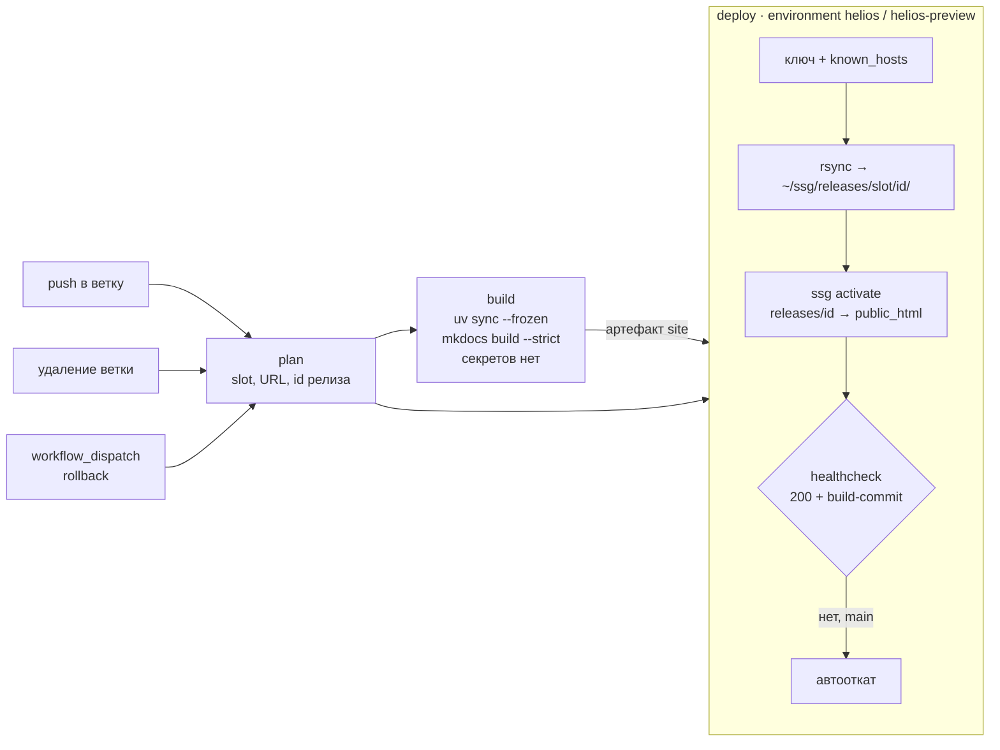

# P4. Развёртывание на Helios с контролем качества доставки

## Схема



| Событие | Что происходит |
|---|---|
| push в `main` | сборка → релиз `<время>-<sha>` → `~/public_html/` → healthcheck; при провале — автооткат на предыдущий релиз и ошибка job |
| push в другую ветку | сборка → `~/public_html/preview/<ветка>/` (имя ветки очищено до `[A-Za-z0-9._-]`), `site_url` указывает на подкаталог |
| удаление ветки | удаление её preview и релизов |
| workflow_dispatch `rollback` | возврат на предыдущий релиз (или на указанный id) без пересборки |
| push, изменён только `README.md` | не запускается |
| `vars.HELIOS_USER` не задан (форк, ещё не настроенный репозиторий) | весь workflow пропускается, а не падает |

Параллельные выкладки в один слот исключены: `concurrency: helios-<slot>`, `cancel-in-progress: false`.

## Deploy-ключ и шлюз

Отдельная пара ed25519 только для CI (`pyengin-ssg-deploy`). Публичная часть добавлена в `~/.ssh/authorized_keys`
на Helios с ограничениями:

```text
restrict,command="/home/studs/sXXXXXX/ssg/bin/ssg-gate.sh" ssh-ed25519 AAAA… pyengin-ssg-deploy
```

`restrict` запрещает PTY и все виды проброса. `command=` подменяет любую запрошенную команду шлюзом
[`scripts/helios-gate.sh`](https://github.com/bailaa/pyengin-ssg/blob/main/scripts/helios-gate.sh). Шлюз разбирает
`$SSH_ORIGINAL_COMMAND` и пропускает только:

- `rsync --server … . ssg/releases/<slot>/<id>/` — приём файлов (не отдачу) в каталог релизов, без опций,
  пишущих в произвольные пути (`--log-file`, `--temp-dir` и т. п.);
- `ssg current|activate|rollback|list|remove|check`.

Проверка шлюза на попытках злоупотребления (локально, с поддельным `$HOME`):

| `SSH_ORIGINAL_COMMAND` | Результат |
|---|---|
| *(пусто — интерактивный вход)* | отказ |
| `bash`, `cat .ssh/authorized_keys` | отказ |
| `rsync --server --sender … public_html/` (скачать файлы) | отказ: чтение с сервера |
| `rsync --server … . public_html/` (писать мимо releases) | отказ: аргумент |
| `rsync --server … . ssg/releases/main/../../.ssh/` | отказ: путь |
| `rsync --server --log-file=x …` | отказ: опция |
| `rsync … ssg/releases/main/x; rm -rf ~` | отказ: спецсимволы |
| `ssg activate main $(id)` | отказ: спецсимволы |
| `ssg remove main` | отказ |
| `ssg check https://evil.com/ …` | отказ: URL |

Итог по T4: украденный ключ позволяет залить и активировать **содержимое сайта**, но не даёт shell, не даёт читать
другие файлы студента и не позволяет изменить сам шлюз или `authorized_keys`.

## Релизы, preview и откат

```text
~/ssg/releases/main/20261012T150102Z-0d340f2/   ← полный снимок сайта
~/ssg/releases/main/20261012T153344Z-9ab1c3e/   ← совпадающие файлы — жёсткие ссылки на предыдущий
~/ssg/state/main/current, previous
~/public_html/                                  ← копия текущего релиза (кроме preview/)
~/public_html/preview/<ветка>/
```

Хранятся 5 последних релизов каждого слота (`current` и `previous` не удаляются никогда). Откат
(`ssg rollback main`) копирует предыдущий релиз в `public_html` за секунды, без пересборки и без CI. Повторный откат
возвращает исходную версию.

Почему не символическая ссылка `public_html → releases/<id>`: атомарное переключение `ln -sfn` было бы лучше, но
Apache на Helios отдаёт `~/public_html` через `UserDir`. Поведение с символическими ссылками
(`FollowSymLinks`/`SymLinksIfOwnerMatch`) зависит от конфигурации сервера, которую студент не контролирует. Поэтому
активация — `rsync --checksum --delete` из релиза в `public_html` внутри сервера.

### Обрыв развёртывания на середине

| Где оборвалось | Что видит читатель | Восстановление |
|---|---|---|
| сборка или lint | ничего не меняется | исправить и запушить |
| загрузка `rsync` в `releases/<id>/` | ничего не меняется — `public_html` не тронут, недогруженный релиз не активируется (`ssg activate` проверяет `index.html`) | повторный запуск job; rsync докачает только недостающее |
| активация (копирование внутри Helios) | SIGHUP игнорируется, копирование завершается даже при обрыве SSH. При сбое самого сервера — смесь версий на несколько секунд | `ssg rollback main` или повторная активация |
| healthcheck не прошёл | в `main` — автооткат на предыдущий релиз, job красная | разбор лога |

## Тексты пайплайнов

??? example "`.github/workflows/helios.yml`"
    ```yaml linenums="1"
    --8<-- ".github/workflows/helios.yml"
    ```

??? example "`.github/workflows/pages.yml`"
    ```yaml linenums="1"
    --8<-- ".github/workflows/pages.yml"
    ```

??? example "`scripts/healthcheck.sh`"
    ```bash linenums="1"
    --8<-- "scripts/healthcheck.sh"
    ```

## Измерения и сравнение с GitHub Pages

--8<-- "snippets/p4_runs.md"
